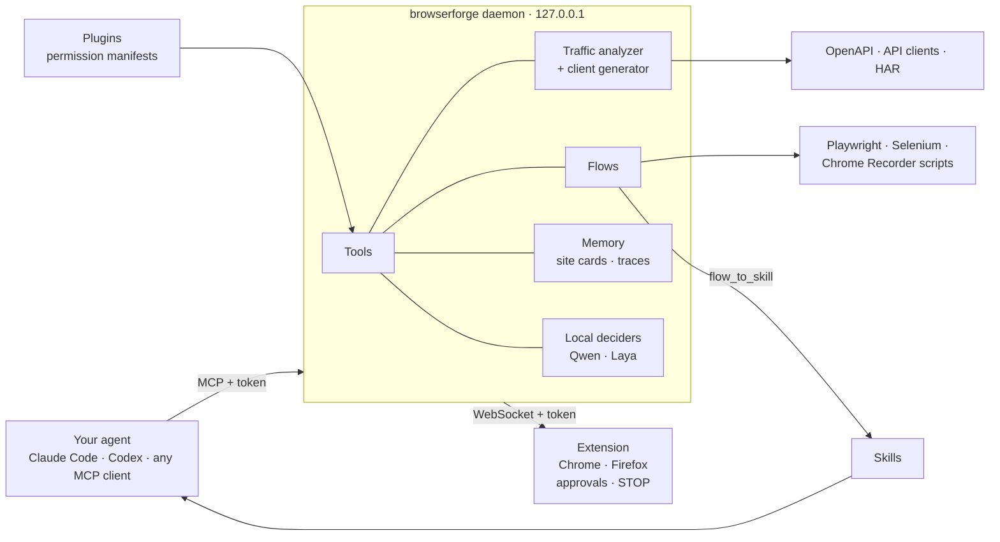

<div align="center">

**English** · [Français](docs/README.fr.md) · [العربية](docs/README.ar.md)


# BrowserForge MCP

**Give your AI agent a real browser, and turn the traffic it sees into API docs and clients.**

A local-first Firefox + Chrome extension and MCP server for Claude Code, OpenAI Codex and any other MCP client.

### Install the extension

<a href="https://chromewebstore.google.com/detail/browserforge/ihbkpcclcolaeppmfgmndmemjljmiaec"></a>&nbsp;&nbsp;
<a href="https://addons.mozilla.org/en-US/firefox/addon/browserforge/"></a>&nbsp;&nbsp;
<a href="https://github.com/zoghlamimostafa/BrowserForge-MCP/releases/latest"></a>

Chrome, Edge and Brave use the Chrome Web Store build. Then install the small local program: on **Windows** run the installer above (it brings its own Node.js; Windows may warn because it is not code-signed yet: *More info*, then *Run anyway*), elsewhere see [Quick start](#quick-start).

<a href="docs/assets/demo.mp4"></a>

<sub>The approval step (12 s). <a href="docs/assets/demo.mp4"><b>Watch the full 73-second demo (MP4)</b></a>: fill a form, approve the submit, turn traffic into an OpenAPI spec, open the dashboard. Recorded on the demo site in this repo; a script plays the agent. Re-record it with <code>npm run demo:record</code>.</sub>

[](https://www.npmjs.com/package/@el-makina-ai/browserforge-mcp)
[](https://github.com/zoghlamimostafa/BrowserForge-MCP/actions/workflows/ci.yml)
[](https://github.com/zoghlamimostafa/BrowserForge-MCP/releases/latest)


</div>

---

## The idea

AI agents are good at deciding what to do on a website and bad at being trusted with your accounts. BrowserForge closes that gap: the agent works in **your real browser** through an extension, a small **local program** carries its requests, and **you approve** anything consequential (submit, send, pay, passwords, uploads) with a click the agent cannot answer. What the agent sees and learns stays on your computer and is turned into reusable things: replayable **flows**, shareable **skills**, and **API specs and clients** built from the traffic it observed. The longer story, how this differs from headless automation and other browser bridges, and where the project is going: **[docs/VISION.md](docs/VISION.md)**.

## Why BrowserForge

| | |
|---|---|
| **Real browser, real session** | A WebExtension, not a headless clone: your tabs, your logins, your cookies. |
| **Local-first** | Everything runs on `127.0.0.1`. No cloud service, no API credits. |
| **Reverse-engineer APIs** | Capture traffic, then get endpoints, schemas, auth and pagination, an OpenAPI 3.1 spec and Python / TypeScript / JavaScript / PHP clients. |
| **Human in the loop** | Submitting forms, purchases, sending, accepting terms, passwords and uploads wait for a click in the extension popup that the agent cannot answer. A red **STOP** halts the agent until you resume. |
| **Honest output** | Every inferred API fact is labelled `observed`, `inferred` or `hypothesis` with confidence and evidence. Per-browser capture limits are documented in [docs/LIMITATIONS.md](docs/LIMITATIONS.md). |
| **Secure by default** | Token-authenticated loopback transports, Origin/Host checks, strict schemas, secret redaction, path-safe file access. See [docs/SECURITY.md](docs/SECURITY.md). |

## Quick start

Requires Node.js 22 or newer, and Chrome, Edge, Brave or Firefox, on Linux, macOS or Windows (Linux is the one it has been tested on; see [docs/INSTALL.md](docs/INSTALL.md)).

```bash
# From npm (no build): npm install -g @el-makina-ai/browserforge-mcp   then:   browserforge setup
# From a checkout:
npm install && npm run build
node apps/mcp-server/dist/cli.js serve     # prints endpoints, creates tokens in ~/.config/browserforge/
node apps/mcp-server/dist/cli.js tokens    # shows the extension token
```

1. **Install the extension** from the store:
   - [Chrome Web Store](https://chromewebstore.google.com/detail/browserforge/ihbkpcclcolaeppmfgmndmemjljmiaec) (Chrome, Edge, Brave)
   - [Firefox Add-ons](https://addons.mozilla.org/en-US/firefox/addon/browserforge/)

   Working from a checkout? Load your own build instead:
   - Firefox: `about:debugging#/runtime/this-firefox` → *Load Temporary Add-on* → `apps/firefox-extension/dist/firefox/manifest.json`
   - Chrome: `chrome://extensions` → Developer mode → *Load unpacked* → `apps/firefox-extension/dist/chrome`
2. **Connect it.** Click the toolbar icon, paste the **extension token**, press *Connect*.
3. **Connect your agent.** Guides: [Codex](docs/CODEX.md) · [Claude Code](docs/CLAUDE_CODE.md)
   ```bash
   codex mcp add browserforge --url http://127.0.0.1:7345/mcp --bearer-token-env-var BROWSERFORGE_MCP_TOKEN
   claude mcp add --transport http browserforge http://127.0.0.1:7345/mcp --header "Authorization: Bearer $(cat ~/.config/browserforge/mcp-token)"
   ```
4. **Try it.** Start the demo site with `node tests/fixtures/demo-site/server.mjs`, then ask your agent:

   > Call `system_status`, then open `http://127.0.0.1:8099/apply` and describe the form.

Full instructions: [docs/INSTALL.md](docs/INSTALL.md) · guides in the [wiki](https://github.com/zoghlamimostafa/BrowserForge-MCP/wiki) · what is planned: the [roadmap board](https://github.com/users/zoghlamimostafa/projects/1). Problems: [docs/TROUBLESHOOTING.md](docs/TROUBLESHOOTING.md).

## Things you can ask your agent

- *"Open this site, click through the checkout flow, and tell me which API calls it makes."*
- *"Analyze the captured traffic and generate an OpenAPI spec and a Python client for the endpoints I used."*
- *"Fill in the application form from my saved profile, show me a preview, and wait for my approval before submitting."*
- *"Export the capture as a HAR file with secrets redacted."*

**From a website to a working API client**, in one conversation: the agent browses the shop, BrowserForge analyses the requests it saw (by code, not a model), writes an OpenAPI spec and a Python client that passes its own tests, and the client fetches real data:

<a href="docs/assets/demo-api.mp4"></a>

<sub><a href="docs/assets/demo-api.mp4"><b>Watch the 41-second API demo (MP4)</b></a>. Recorded on the demo site in this repo with <code>npm run demo:record -- --scene api</code>; a script plays the agent.</sub>

More end-to-end examples: [docs/WORKFLOWS.md](docs/WORKFLOWS.md).

## Tools

| Namespace | Tools |
|---|---|
| **browser** | `browser_get_tabs`, `browser_get_active_tab`, `browser_select_tab`, `browser_close_tab`, `browser_navigate`, `browser_click`, `browser_type`, `browser_fill_field`, `browser_select_option`, `browser_scroll`, `browser_press_key`, `browser_get_page_text`, `browser_get_dom_snapshot`, `browser_get_interactive_elements`, `browser_take_screenshot`, `browser_wait_for_element`, `browser_get_forms`, `browser_extract_table`, `browser_verify`, `browser_fill_form`, `browser_get_downloads`, `browser_get_console_errors`, `browser_solve_captcha`, `browser_pending_requests`, `browser_pause`, `browser_resume`, `browser_stop` |
| **network** | `network_list_requests`, `network_get_request`, `network_get_request_details`, `network_search_requests`, `network_list_captures`, `network_configure_capture`, `network_export_har`, `network_import_har`, `network_clear_capture` |
| **api** (reverse engineering) | `api_analyze_traffic`, `api_list_endpoints`, `api_get_endpoint_details`, `api_generate_openapi`, `api_generate_client` |
| **form** | `form_profile_save`, `form_profile_list`, `form_profile_delete`, `form_discover`, `form_fill_from_profile`, `form_validate`, `form_preview_submission`, `form_prepare_cover_letter` |
| **goal** (optional, local model) | `browser_run_goal`, `browser_goal_feedback` |
| **knowledge** | `knowledge_add_document`, `knowledge_search`, `knowledge_list`, `knowledge_remove`, `knowledge_export_dataset` |
| **flows** | `flow_list`, `flow_get`, `flow_save`, `flow_delete`, `flow_record`, `flow_export`, `flow_run`, `flow_consolidate`, `flow_to_skill` |
| **sites** | `site_info`, `site_note`, `site_list` |
| **skills** | `skill_list`, `skill_get`, `skill_run_workflow` (plus one prompt per skill) |
| **plugins** | whatever the plugins you install add, e.g. `cv_*` from the RenderCV plugin |
| **workflow** | `workflow_create`, `workflow_run`, `workflow_pause`, `workflow_resume`, `workflow_get_status` |
| **system** | `system_status`, `system_diagnostics` |

Read-only tools carry `readOnlyHint`. Every tool has a strict JSON schema (unknown arguments are rejected) and bounded output.

`browser_run_goal` is an optional fast path: **local** models pick one routine step at a time from a compact table of the page. By default Qwen (via Ollama) decides; `--decider cascade` puts Laya (via [Ollaya](https://github.com/ollaya-dev/ollaya)) first with Qwen as backup. The run hands back to your agent when the models are unsure, and every step says which model decided. It only types values you pass in, never navigates to other sites, and goes through the same approval gate as every other action.

Analysis and code generation themselves are deterministic and use no LLM.

## Every site becomes a flow

BrowserForge records what an agent does on each website as a **flow**: steps, several ways to find each element, and your typed values as named parameters (passwords are never kept). Replay a flow with no model (`flow_run`), or export it as a script for **Playwright** (TypeScript, Python), **Selenium** (Python, Java), **Chrome DevTools Recorder / Puppeteer Replay**, or neutral JSON:

```bash
browserforge flow list
browserforge flow export <id> --format playwright-ts --out signup.ts
FLOW_CONFIRM=1 FLOW_PARAM_FIRST_NAME=Grace npx tsx signup.ts
```

Exported scripts stop before submits, sends and uploads unless you say `FLOW_CONFIRM=1`, since outside BrowserForge there is no approval prompt. Details: [docs/FLOWS.md](docs/FLOWS.md).

### An agent window, and tables as data

* **Agent window:** turn it on in the popup and the agent works in its own window instead of the tabs you are using; it can still use one of yours when it selects it on purpose. **Take over** stops the agent and shows its window so you can finish by hand; **Hand back** lets it carry on. Details: [docs/AGENT_WINDOW.md](docs/AGENT_WINDOW.md).
* **Tables:** `browser_extract_table` reads HTML tables and ARIA grids (also inside iframes) as column names and rows, with merged cells expanded, as JSON or CSV (spreadsheet formulas neutralised), or saved to a file so a big table does not fill the agent's context.

### Memory that carries over

* **Site cards:** navigating to a site returns what is known about it (obstacles, past results, flows to replay); agents add to it with `site_note`. See [docs/SITES.md](docs/SITES.md).
* **Automatic checks:** after a submit, and at the end of `browser_run_goal`, the page is read for a confirmation or an error, and the run is labelled good or bad without waiting for anyone. `browser_verify` does it on demand.
* **Flows to skills:** `flow_consolidate` merges many recordings of a task into one clean flow, and `flow_to_skill` turns it into a shareable skill that replays with no model.
* **Record me:** an opt-in popup switch that also records *your own* clicks and fields as a flow and as training examples for the local model. Off by default, passwords never recorded, everything stays on your computer.

### A dashboard for what is installed

`browserforge dashboard` opens a page on your own computer: connected browsers, MCP sessions and every tool, the plugins and skills you installed (with the permissions you approved, in plain words), recorded flows and how the local models are doing. It only reads, except that you can switch a plugin on or off, and only after you approve it in the browser extension. It has its own token. Details: [docs/DASHBOARD.md](docs/DASHBOARD.md).

## Extend BrowserForge: plugins and skills

Anyone can add to BrowserForge without touching the core:

* **Skills**: a folder with a `SKILL.md` (and optional ready-made workflows). No code; agents read it. `browserforge skill new my-skill`. [docs/SKILLS.md](docs/SKILLS.md)
* **Plugins**: a small ES module that adds tools, with a manifest of exactly which folders, programs, browser access and public HTTPS origins it needs. You see that list in plain words and approve it before it is installed; a later version asking for more is switched off until you approve again. `browserforge plugin new my-tool`. [docs/PLUGINS.md](docs/PLUGINS.md)

```bash
browserforge plugin search cv            # npm packages tagged "browserforge-plugin"
browserforge plugin add ./plugins/rendercv
browserforge plugin config rendercv cvDir=~/cv rendercv=~/venv/bin/rendercv
```

For a read-only public API example without tokens, see [`examples/plugins/github-stats`](examples/plugins/github-stats).

The first plugin is [`plugins/rendercv`](plugins/rendercv): tailor a RenderCV resume to each job (reorder and reword only; it rejects any number, link or tool name not already in your CV), render it, and keep an application log. Its companion skill [`skills/job-apply`](skills/job-apply) is a worked example of a skill. Contributing: [CONTRIBUTING.md](CONTRIBUTING.md).

## The ecosystem



The extension, the daemon and the typed protocol between them are the core. Flows, skills and plugins are how it grows without touching the core, and the local models and site memory make repeated tasks cheaper. Each part, and where it is heading (a shared library of skills, local models that learn from your demonstrations, more plugins, more browsers and platforms), is in [docs/VISION.md](docs/VISION.md).

## How it works

```
 Claude Code / Codex  ──MCP (HTTP + Bearer)──►  browserforge daemon  ──WebSocket (token + Origin)──►  extension in Firefox / Chrome
                                                 MCP tools · BrowserHub                                 background · content script · popup
                                                 NetworkStore · analyzer · generator                    approvals · STOP
```

1. A tool call is validated against its schema, then sent to the extension with a request id, timeout and cancellation.
2. The extension re-validates it, resolves the tab and element, and runs it in the page.
3. If the action looks consequential, it returns to the human for approval *inside the browser* before anything happens.
4. Results flow back to the agent as redacted, bounded, untrusted data.

Deeper dive: [docs/ARCHITECTURE.md](docs/ARCHITECTURE.md) · [docs/BROWSER_PROTOCOL.md](docs/BROWSER_PROTOCOL.md) · [docs/RESEARCH.md](docs/RESEARCH.md).

## Safety model

- **Page content is data, never instructions.** It is wrapped as untrusted before the agent sees it.
- **Approvals live in the browser.** The agent cannot answer the popup.
- **Secrets are redacted** from what the agent sees, from exports and from generated code. Revealing them requires starting the daemon with `--allow-reveal`.
- **Nothing is persisted** unless you export it. Captured traffic stays in memory.
- **No anti-bot evasion** and no arbitrary-JavaScript tool. CAPTCHA solving exists only as the opt-in `browser_solve_captcha` (local CapSkip app, needs `--capskip` and YOLO mode; see [SECURITY.md](docs/SECURITY.md)).

## Repository layout

```
apps/firefox-extension     cross-browser extension source (builds dist/firefox and dist/chrome)
apps/mcp-server            daemon: MCP (HTTP/stdio), extension WebSocket hub, tools, CLI
packages/browser-protocol  versioned Zod message and action schemas
packages/network-inspector capture store, filters, redacted views, HAR
packages/api-analyzer      traffic to endpoints, schemas, pagination, auth, evidence
packages/client-generator  OpenAPI 3.1, Python/TS/JS/PHP clients, safe writer, validators
packages/knowledge         local reference documents (BM25) and run traces
packages/flows             flow format, builder and exporters (Playwright, Selenium, Chrome Recorder, JSON)
packages/plugin-sdk        what plugin authors import: manifest, permission-checked api, test helper
plugins/                   reference plugins (rendercv)
skills/                    reference skills (job-apply, table-to-csv)
packages/shared            errors, limits, redaction, path safety, tokens, logger
tests/                     unit · security · integration · e2e (real browsers) · demo site
docs/  examples/  CONTRIBUTING.md
```

## Development

| Command | What it does |
|---|---|
| `npm run build` | TypeScript project build and extension bundles |
| `npm run typecheck` | `tsc` for packages, server, extension and tests |
| `npm run lint` | ESLint and `web-ext lint` |
| `npm test` | unit, security and integration tests (no browser needed) |
| `npm run test:e2e` | real Firefox (geckodriver) and Chromium (Playwright); `BF_BROWSERS=firefox` to pick one |
| `npm run package` | `artifacts/browserforge-{firefox,chrome}-<version>.zip` |
| `npm run dev` | rebuild on change and restart the daemon |

## Status and limitations

Version 0.2.1 (the Chrome Web Store and Firefox Add-ons are updated after each release), published on the Chrome Web Store and Firefox Add-ons. BrowserForge reports what a WebExtension can actually see; it does not capture all browser traffic. For example, Firefox cannot observe WebSocket frames, closed shadow roots and sandboxed iframes are invisible to it, and consequential-action detection is heuristic.

Read [docs/LIMITATIONS.md](docs/LIMITATIONS.md) for the full list and [docs/RELEASE_CHECKLIST.md](docs/RELEASE_CHECKLIST.md) for the manual checks still required before a release.

## Responsible use

Use BrowserForge only on sites and accounts you are authorised to automate or inspect, and respect their terms of service and the law. It is built for your own sessions and for legitimate testing, integration and documentation work.

## Support the project

If BrowserForge saves you time, a ⭐ on this repository helps other people find it. Ideas, questions and plugins are welcome in [Discussions](https://github.com/zoghlamimostafa/BrowserForge-MCP/discussions); things you can pick up right now are the [issues marked *help wanted*](https://github.com/zoghlamimostafa/BrowserForge-MCP/issues?q=is%3Aopen+label%3A%22help+wanted%22), and the plan is on the [roadmap board](https://github.com/users/zoghlamimostafa/projects/1).

## License

MIT. See [LICENSE](LICENSE) and [NOTICE](NOTICE).
