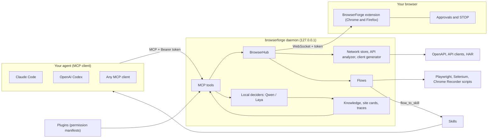

# Vision: the idea, what is different, the ecosystem, where it goes

  &nbsp;&nbsp;
  

## The idea

AI agents are good at deciding what to do on a website and bad at being trusted with your accounts. BrowserForge starts from that gap.

* **The agent works in your real browser.** Not a headless copy: your tabs, your logins, your cookies. The extension is the only thing that touches the page.
* **A small program on your computer is the brain's doorway.** The `browserforge` daemon speaks MCP to Claude Code, OpenAI Codex or any other MCP client, and talks to the extension over a token-protected connection on `127.0.0.1`. There is no BrowserForge server, account or telemetry.
* **You stay in charge, inside the browser.** Submitting, sending, paying, uploading and typing passwords wait for a click in the extension popup. The agent cannot answer that popup, and a red **STOP** halts everything.
* **What the agent learns stays with you and gets reused.** Every task is recorded as a *flow*; flows become replayable scripts and shareable *skills*; the traffic it saw becomes an OpenAPI spec and API clients; per-site notes make the next visit faster.

The goal is an agent that does the routine web work you would otherwise do by hand, gets cheaper and more reliable each time it repeats a task, and never needs your trust beyond what you can see and approve.

## How it is different

BrowserForge sits between three kinds of tool. The table describes the *categories*, plus the two projects that [docs/RESEARCH.md](RESEARCH.md) inspected in detail. It describes how BrowserForge is built, not a ranking.

| | Headless browser automation (Playwright / Puppeteer style) | Extension-bridge MCP servers (e.g. Blueprint MCP) | LLM-driven reverse-API tools (e.g. Reverse API Engineer) | **BrowserForge** |
|---|---|---|---|---|
| Uses your real, logged-in session | No, a fresh profile | Yes | No, drives its own browser | **Yes** |
| Runs fully on your computer | Yes | Mostly; some offer a paid cloud relay | Needs a model provider for its agent mode | **Yes, no cloud part exists** |
| Human approval the agent cannot answer | Not built in | Not the focus | Not built in | **Yes, in the extension popup, plus STOP** |
| Arbitrary JavaScript tool for the agent | Yes | Often (`browser_evaluate`) | n/a | **No, by design** |
| API docs and clients from captured traffic | No | No | Yes, but written by an LLM | **Yes, deterministic, every fact labelled `observed` / `inferred` / `hypothesis`** |
| Tasks become reusable assets | You write the scripts | No | Generated clients | **Flows → Playwright / Selenium / Chrome Recorder exports, and skills** |
| Cheap routine steps | n/a | No | No | **Optional local model (Qwen / Laya) picks routine steps; your agent supervises** |
| Anti-bot evasion | Often added | Varies | Uses stealth plugins | **None, on purpose** |

Three choices explain most of the table:

1. **The approval gate lives where the agent cannot reach it.** Policy enforced in the agent's prompt can be argued with; a popup in the browser cannot.
2. **Page content is data, never instructions.** It is wrapped as untrusted before the agent sees it, and secrets are redacted from what it sees, from exports and from generated code.
3. **Analysis is deterministic.** Endpoints, schemas, pagination, auth and the generated clients come from code, not from a model's guess, so the same traffic gives the same answer and an honest confidence label.

## The ecosystem

| Layer | What it is | Where |
|---|---|---|
| **Extension** | One WebExtension code base building for Firefox and Chrome: background, content script, popup (approvals, STOP, agent window, Record me). | [apps/firefox-extension](../apps/firefox-extension) · store pages: [Chrome](https://chromewebstore.google.com/detail/browserforge/ihbkpcclcolaeppmfgmndmemjljmiaec) · [Firefox](https://addons.mozilla.org/en-US/firefox/addon/browserforge/) |
| **Daemon** | MCP server (HTTP and stdio), extension hub, tools, CLI. | [apps/mcp-server](../apps/mcp-server) |
| **Protocol** | Versioned, schema-validated messages between daemon and extension. | [packages/browser-protocol](../packages/browser-protocol) · [BROWSER_PROTOCOL.md](BROWSER_PROTOCOL.md) |
| **Reverse engineering** | Capture store and HAR, traffic analyzer, OpenAPI and client generator (Python, TypeScript, JavaScript, PHP). | [packages/network-inspector](../packages/network-inspector) · [api-analyzer](../packages/api-analyzer) · [client-generator](../packages/client-generator) |
| **Memory** | Reference documents (BM25), run traces, per-site cards. | [packages/knowledge](../packages/knowledge) · [SITES.md](SITES.md) |
| **Flows** | Recorded tasks, consolidation, exports, replay without a model. | [packages/flows](../packages/flows) · [FLOWS.md](FLOWS.md) |
| **Local deciders** | Optional Qwen (Ollama) and Laya (Ollaya) that choose one routine step at a time, supervised by your agent. | [FINETUNING.md](FINETUNING.md) · [SECURITY.md](SECURITY.md) |
| **Dashboard** | A local page: tools, plugins with their approved permissions (and a switch that waits for your approval in the extension), skills, flows, local models. | [DASHBOARD.md](DASHBOARD.md) · `browserforge dashboard` |
| **Plugins and skills** | Extension points anyone can write without touching the core. | [PLUGINS.md](PLUGINS.md) · [SKILLS.md](SKILLS.md) · [plugins/rendercv](../plugins/rendercv) · [skills/job-apply](../skills/job-apply) |

## Long-term vision

The planned work is on the public [roadmap board](https://github.com/users/zoghlamimostafa/projects/1); the [wiki](https://github.com/zoghlamimostafa/BrowserForge-MCP/wiki) has the friendly guides. Each direction says what exists **today** and what comes **next**. "Next" is direction, not a schedule or a promise.

### 1. From flows to a library of skills

*Today.* Every task is recorded as a flow (`flow_list`); `flow_task_begin` / `flow_task_end` record a scripted task as one clean flow with its outcome; `flow_consolidate` merges many recordings into one; `flow_to_skill` turns it into a skill that replays with no model; flows export to Playwright, Selenium and Chrome Recorder, with typed values as named parameters and passwords never kept.

*Next.* Skills that people can share and install like plugins, so "apply on this job portal" or "download my invoices from this supplier" is something you install and run, not something you re-teach. Sharing needs trust, so shared skills stay guidance: they can never skip an approval.

### 2. Local models that learn from you

*Today.* An optional local decider (Qwen by default, or a Laya → Qwen cascade) picks one routine step at a time from a compact table of the page. Every step says which model chose it; your agent checks the result and calls `browser_goal_feedback`; `knowledge_list` shows a scorecard per model. The opt-in **Record me** switch records your own actions as training examples, and [FINETUNING.md](FINETUNING.md) shows how to turn them into a model. No model has been fine-tuned on recorded demonstrations yet; [LIMITATIONS.md](LIMITATIONS.md) says so too.

*Next.* Close the loop: demonstrations and good runs train a small local model, so routine pages cost your cloud agent fewer tokens and the expensive model is called only when the cheap one is unsure.

### 3. A plugin ecosystem with visible permissions

*Today.* Plugins add tools through a small SDK. A manifest lists exactly which folders, programs and browser access a plugin needs, in plain words, and you approve that before install; a later version asking for more is switched off until you approve again. `browserforge plugin search` finds npm packages tagged `browserforge-plugin`. The first plugin, [rendercv](../plugins/rendercv), tailors a resume to a job without adding a single claim that is not in your master CV.

The read-only [dashboard](DASHBOARD.md) shows what is installed and which permissions you approved.

*Next.* More third-party plugins, in the same spirit: narrow tools, honest manifests, and checks in the plugin itself that keep the agent from inventing facts about you. Switching a plugin on or off from the dashboard, with the approval in the browser.

### 4. More browsers and platforms

*Today.* Firefox and Chrome (Edge and Brave load the Chrome build) from one code base. Linux is the platform it has been tested on. Windows has a one-file installer that carries its own Node.js (built and smoke-tested on a Windows runner for each release); Windows and macOS are documented in [INSTALL.md](INSTALL.md) with what is and is not known.

*Next.* Tested macOS and Windows installs, then other browsers where the WebExtension model allows it. Mobile (Android) is an idea worth exploring through the same protocol, not something that exists yet: what is known and what is not is written down in [ANDROID.md](ANDROID.md), and the same for Safari in [SAFARI.md](SAFARI.md).

## Principles that will not change

* **Local-first.** Nothing leaves your computer because of BrowserForge itself.
* **The human approves.** Consequential actions are answered in the browser, never by the agent.
* **Page content is data.** Never instructions, never a reason to skip an approval.
* **No anti-bot evasion.** CAPTCHAs and logins are for you, apart from one opt-in solver.
* **Honest output.** What cannot be seen is documented in [LIMITATIONS.md](LIMITATIONS.md), and every inferred API fact says how sure it is.
* **Open source.** MIT, with contributions welcome: [CONTRIBUTING.md](../CONTRIBUTING.md).
